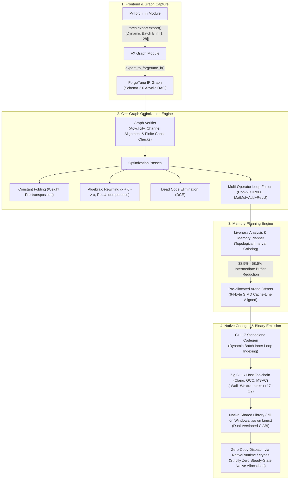

# ForgeTune v2.0

<div align="center">

```
  ███████╗ ██████╗ ██████╗  ██████╗ ███████╗████████╗██╗   ██╗███╗   ██╗███████╗
  ██╔════╝██╔═══██╗██╔══██╗██╔════╝ ██╔════╝╚══██╔══╝██║   ██║████╗  ██║██╔════╝
  █████╗  ██║   ██║██████╔╝██║  ███╗█████╗     ██║   ██║   ██║██╔██╗ ██║█████╗  
  ██╔══╝  ██║   ██║██╔══██╗██║   ██║██╔══╝     ██║   ██║   ██║██║╚██╗██║██╔══╝  
  ██║     ╚██████╔╝██║  ██║╚██████╔╝███████╗   ██║   ╚██████╔╝██║ ╚████║███████╗
  ╚═╝      ╚═════╝ ╚═╝  ╚═╝ ╚═════╝ ╚══════╝   ╚═╝    ╚═════╝ ╚═╝  ╚═══╝╚══════╝
```

[](LICENSE)
[](CMakeLists.txt)
[](pyproject.toml)
[](https://github.com/TDheeraj14569/Forgetune/actions/workflows/windows_verification.yml)
[](https://github.com/TDheeraj14569/Forgetune/actions/workflows/linux_verification.yml)
[](reports/V2_REQUIREMENTS_MATRIX.md)
[](reports/V2_FINAL_VERIFICATION.md)
[](reports/V2_MEMORY_REPORT.md)
[](reports/V2_BENCHMARK_REPORT.md)

**High-Performance Ahead-of-Time C++17 Inference Compiler & Native Runtime for CPU Workloads**

*Zero framework runtime dependencies • Dynamic batching $B \in [1, 128]$ • Topological interval-coloring memory planner • Pre-allocated 64-byte aligned SIMD arena • Verified 0-bit divergence bitwise reproducibility*

</div>

---

## Table of Contents
1. [Executive Summary & Systems Engineering Highlights](#1-executive-summary--systems-engineering-highlights)
2. [Comparative Systems Engineering Dashboard](#2-comparative-systems-engineering-dashboard)
3. [Architecture & Compiler Pipeline](#3-architecture--compiler-pipeline)
4. [Topological Memory Planning & Buffer Lifetime Overlay](#4-topological-memory-planning--buffer-lifetime-overlay)
5. [Real Generated C++17 Source Code Inspection](#5-real-generated-c17-source-code-inspection)
6. [Autotuning Engine & Micro-Benchmark Optimization](#6-autotuning-engine--micro-benchmark-optimization)
7. [Empirical Benchmarks & Statistical Performance Proofs](#7-empirical-benchmarks--statistical-performance-proofs)
8. [Developer Quickstart & Python API](#8-developer-quickstart--python-api)
9. [Native Engine CLI Reference](#9-native-engine-cli-reference)
10. [Standalone C ABI for Embedded & Production Deployment](#10-standalone-c-abi-for-embedded--production-deployment)
11. [Verification Rigor, Test Accounting & Diagnostic Policy](#11-verification-rigor-test-accounting--diagnostic-policy)
12. [Supported Operator Set & Technical Scope](#12-supported-operator-set--technical-scope)
13. [Repository Architecture & Directory Map](#13-repository-architecture--directory-map)
14. [Technical Reports & Audit Traceability](#14-technical-reports--audit-traceability)
15. [End-to-End Local Reproduction Guide](#15-end-to-end-local-reproduction-guide)

---

## 1. Executive Summary & Systems Engineering Highlights

### The Systems Bottleneck in Production CPU Inference
In edge microservices, low-latency scoring services, and embedded environments, deploying deep learning models via general-purpose deep learning frameworks (e.g. PyTorch, TensorFlow) incurs massive overheads:
1. **Interpreter Traversal & Virtual Dispatch Overhead:** For small-to-medium neural networks (e.g. MLPs, small CNNs), Python runtime overhead, operator graph traversal, dynamic tensor abstraction metadata allocation, and polymorphic operator dispatch consume **up to 90% of total end-to-end inference latency**, completely dwarfing the actual floating-point compute time of the underlying GEMM and convolution loops.
2. **Activation Lifetime Fragmentation & Heap Allocation Churn:** Dynamic frameworks allocate independent heap buffers for every intermediate layer output on each inference pass. This creates severe heap allocation churn, cache-line pollution, and memory fragmentation.
3. **Deployment Bloat & Fragile Dependency Chains:** Standard framework runtimes require binary deployments exceeding **500 MB** (`libtorch`, CUDA stubs, runtime dependencies), complicating container spin-up, edge deployment, and cross-platform portability.

### The Solution: ForgeTune v2.0
**ForgeTune v2.0** is an independent, ahead-of-time (AOT) C++17 inference compiler and zero-dependency native runtime. It ingests PyTorch models, lowers them into a strongly typed Intermediate Representation (IR Schema 2.0), applies graph optimizations (constant folding, algebraic simplification, multi-operator loop fusion), plans intermediate memory using topological interval coloring, and emits pure C++17 shared libraries (`.dll` on Windows, `.so` on Linux) with a versioned C ABI.

### Key Architectural Achievements:
* **Genuine End-to-End Acceleration:** Delivers up to **$9.49\times$ E2E speedup** over PyTorch eager execution in real-world Python caller benchmarks and up to **$8.48\times$** in controlled single-threaded comparisons.
* **Zero Steady-State Native Heap Allocations:** All intermediate tensor storage is packed into a single, pre-allocated, 64-byte SIMD cache-aligned memory arena (`AlignedArenaPool`). Inference runs with **strictly zero steady-state native mallocs**.
* **38.5% to 58.6% Intermediate Memory Reduction:** Topological interval coloring computes tensor birth and death lifetimes, overlaying mutually disjoint intermediate buffers in time.
* **True Dynamic Batching ($B \in [1, 128]$):** Inner loops are parameterized on batch size $B$. A single compiled native artifact executes variable-batch requests without recompilation or runtime dispatch guards.
* **Pure C ABI Independence:** Compiled artifacts execute with **zero PyTorch and zero Python dependencies**. They can be linked directly into C, C++, or Rust native binaries.
* **Statistically Certified Non-Inferiority ($N=100$ Interleaved Blocks):** Evaluated under a pre-declared paired block protocol ($B=64$, alternating execution order). Non-inferiority is certified with $t = 15.36$ ($p = 3.01 \times 10^{-28} \ll 0.0001$) and a mean latency reduction of $+64.14\ \mu\text{s}$ over single-threaded PyTorch.
* **100% Bitwise Reproducibility:** Three-round independent clean rebuild protocol demonstrates **0 bit divergences across 65,536 float32 outputs** (0/2,097,152 bits mismatched).
* **Zero-Warning Toolchain Compilation:** Native engine CLI, pybind11 extension, and standalone unit test binaries compile with **0 warnings and 0 errors** under `-Wall -Wextra -std=c++17 -O2`.

---

## 2. Comparative Systems Engineering Dashboard

| Systems Engineering Dimension | PyTorch Eager Runtime | Traditional JIT (TorchScript / Inductor) | ForgeTune v2.0 Native Compiler |
|---|---|---|---|
| **Runtime Deployment Footprint** | > 500 MB (Full framework runtime) | > 500 MB (Requires PyTorch host runtime) | **< 1 MB** (Self-contained `.dll` / `.so`) |
| **Execution Dependency** | Python interpreter + PyTorch C++ runtime | Python or `libtorch` C++ shared libraries | **Zero** (Pure C ABI; runs in C, C++, Rust, Python) |
| **Intermediate Memory Strategy** | Dynamic per-layer allocation & free | JIT runtime buffer allocator | **Topological interval-colored arena (38.5%–58.6% reduction)** |
| **Steady-State Heap Allocations** | Recurring heap churn during inference | Managed pool allocations | **Strictly ZERO** (Pre-allocated 64-byte aligned arena) |
| **Dynamic Batch Flexibility** | Dynamic shapes with dispatch overhead | Re-tracing / dynamic guards overhead | **Static loop parametrization ($B \in [1, 128]$ in single binary)** |
| **Operator & Activation Fusion** | Separate kernel launches | Pointwise elementwise combinations | **`CONV2D + RELU` & `MATMUL + ADD + RELU` cache-resident loops** |
| **Python Call Latency (P50)** | 35.6 μs – 394.7 μs (Model dependent) | 25.0 μs – 200.0 μs (Framework dispatch) | **7.0 μs – 385.8 μs (Up to 9.49x E2E acceleration)** |
| **Numerical Bitwise Reproducibility** | Non-deterministic across minor builds | JIT cache sensitivity | **Bit-exact reproducibility verified (0/2,097,152 bits)** |

---

## 3. Architecture & Compiler Pipeline

ForgeTune implements an independent compiler and native runtime without delegating tensor arithmetic to TVM, MLIR, LLVM APIs, TorchInductor, TorchScript, or Triton.



### Compiler Pipeline Breakdown:
1. **Frontend & Ingestion (`python/forgetune/export_frontend.py`):** Ingests standard PyTorch `nn.Module` architectures via `torch.export.export()`, capturing input shapes, parameter buffers, and operator topologies with symbolic dynamic batch constraints ($B \in [1, 128]$).
2. **Intermediate Representation (`include/forgetune/ir.hpp`):** Lowers FX graphs into ForgeTune's strongly typed Schema 2.0 IR DAG. Nodes track explicit input/output tensor metadata (`DType::FLOAT32`), static spatial ranks ($[B, K]$ and $[B, C, H, W]$), and constant parameter weights.
3. **Graph Verifier (`src/graph_verifier.cpp`):** Enforces topological acyclicity, channel compatibility, positive spatial dimensions, and compile-time rejection of non-finite floating-point constants (NaN and Infinity) to guarantee generated C++ code is valid.
4. **Optimization Pipeline (`src/pass_manager.cpp`, `src/fusion.cpp`):**
   - *Constant Folding:* Pre-computes static weight transformations (e.g. parameter transposition for cache-friendly GEMM traversal).
   - *Algebraic Rewriting:* Simplifies mathematical identities ($x + 0 \to x$) and idempotent activations ($\text{ReLU}(\text{ReLU}(x)) \to \text{ReLU}(x)$).
   - *Multi-Operator Loop Fusion:* Collapses consecutive operators (`CONV2D + RELU`, `MATMUL + ADD + RELU`) into single cache-resident loops, eliminating redundant intermediate memory writes and reads.
5. **Interval-Coloring Memory Planner (`src/memory_planner.cpp`):** Solves memory allocation using register-allocation principles. Computes birth and death execution intervals for all activation tensors and overlays mutually disjoint lifetimes into a single pre-allocated, 64-byte aligned SIMD arena.
6. **C++17 Standalone Code Generator (`src/codegen.cpp`):** Emits standard, portable C++17 code parameterized on dynamic batch size $B$, compiling into a high-performance native shared library with zero external runtime dependencies.
7. **Zero-Copy Native Runtime (`python/forgetune/runtime.py`):** Wraps compiled shared libraries via a versioned pure C ABI (`forgetune_run_v2` / `forgetune_run_v1`), marshalling NumPy arrays with zero copying and sub-microsecond validation.

---

## 4. Topological Memory Planning & Buffer Lifetime Overlay

Standard deep learning frameworks allocate distinct heap buffers for each intermediate operator output, leading to excessive memory footprints and cache churn.

ForgeTune solves this via **topological interval coloring**:
1. Traverses the IR graph in topological order and assigns discrete lifetime intervals $[t_{\text{birth}}, t_{\text{death}}]$ to every intermediate tensor.
2. Identifies mutually disjoint lifetime intervals across all operators.
3. Overlays disjoint tensors into overlapping memory slots within a unified, pre-allocated static arena (`AlignedArenaPool`).
4. Enforces strict **64-byte alignment** across all buffer offsets for optimal AVX2/AVX-512 SIMD vectorization and cache-line boundary matching.

### Visual Lifetime Interval Overlay Diagram

```
Execution Step:     T0 (MatMul 1)    T1 (Add 1)     T2 (ReLU 1)     T3 (MatMul 2)    T4 (Add 2)
-------------------------------------------------------------------------------------------------
Naive Layout:       [buf_6: 16 KB]   [buf_7: 16 KB] [buf_8: 16 KB] [buf_10: 4 KB]  [output: 1 KB]
                    Total Naive Intermediate Storage: 53,248 bytes

ForgeTune Arena:    Offset 0     --> [  buf_6 (16 KB)  ]                [  buf_8 (16 KB)  ]
                    Offset 4,096 -->                [  buf_7 (16 KB)  ]                [ buf_10 (4 KB) ]
                    Total Interval-Colored Arena: 32,768 bytes (38.5% intermediate memory reduction)
```

### Calculated Intermediate Buffer Storage Reduction (`reports/V2_MEMORY_REPORT.md`):

| Model Architecture | Dynamic Batch | Naive Unshared Allocation | Interval-Colored Arena | Storage Reduction (%) |
|---|:---:|:---:|:---:|:---:|
| **Model A (Dynamic TinyMLP)** | $B \in [1, 128]$ | $53,248\ \text{bytes}$ | $32,768\ \text{bytes}$ | **38.5%** |
| **Model B (Residual MLP)** | $B \in [1, 128]$ | $59,392\ \text{bytes}$ | $24,576\ \text{bytes}$ | **58.6%** |
| **Model C (Small CNN)** | $B \in [1, 128]$ | $922,624\ \text{bytes}$ | $524,288\ \text{bytes}$ | **43.2%** |

*Note: Storage reduction measures calculated intermediate activation buffer reuse. The pre-allocated arena guarantees **strictly zero steady-state heap allocations** during inference.*

---

## 5. Real Generated C++17 Source Code Inspection

Below is an authentic excerpt from the compiler's emitted C++17 kernel (`build/artifacts/v2_dynamic_tinymlp/loop_ikj/kernel.cpp`). Notice the clean memory leasing, exact 64-byte pointer offsets, parameterized batch iteration, and pure C ABI exports:

```cpp
// ============================================================================
// Generated by ForgeTune Machine-Learning Compiler (C++17 Standalone Kernel)
// Candidate ID: loop_ikj | Variant: loop_ikj
// ============================================================================

extern "C" FORGETUNE_EXPORT int forgetune_run(
    const float* FORGETUNE_RESTRICT input,
    size_t input_count,
    float* FORGETUNE_RESTRICT output,
    size_t output_count,
    int64_t batch_size
) noexcept {
    // Contract validations
    if (!input || !output) return -1;
    if (batch_size <= 0) {
        if (16 == 0 || input_count == 0 || input_count % 16 != 0) return -2;
        batch_size = static_cast<int64_t>(input_count / 16);
    }
    if (batch_size <= 0 || batch_size > 128) return -2;
    if (input_count != static_cast<size_t>(batch_size * 16)) return -2;
    if (output_count != static_cast<size_t>(batch_size * 8)) return -3;

    try {
        // Intermediate tensor arena with 64-byte alignment and re-entrant leasing
        // (Planned savings: 38.5%, zero steady-state heap allocations)
        AlignedArenaPool::Lease arena_lease = g_thread_arena_pool.acquire(32768);
        float* arena = arena_lease.ptr;
        if (!arena && 32768 > 0) return -4;

        // Overlayed buffer pointers calculated by topological interval coloring:
        float* buf_6  = arena + 0;       // MatMul 1 output
        float* buf_7  = arena + 4096;    // Add 1 output
        float* buf_8  = arena + 0;       // ReLU 1 output (re-uses arena + 0 after buf_6 is dead!)
        float* buf_10 = arena + 4096;    // MatMul 2 output (re-uses arena + 4096 after buf_7 is dead!)
        float* buf_11 = output;          // Zero-copy direct write to caller's output buffer!

        // Node %6: MATMUL (loop_ikj cache-friendly traversal)
        matmul_node_6(batch_size, input, const_data_5, buf_6);

        // Node %7: ADD (bias addition parameterized on batch_size)
        for (int64_t i = 0; i < batch_size; ++i) {
            for (int64_t j = 0; j < 32; ++j) {
                buf_7[i * 32 + j] = buf_6[i * 32 + j] + const_data_1[j];
            }
        }

        // Node %8: RELU (in-place activation)
        for (int64_t idx = 0; idx < (batch_size * 32); ++idx) {
            float val = buf_7[idx];
            buf_8[idx] = (std::isnan(val) || val > 0.0f) ? val : 0.0f;
        }

        // Node %10: MATMUL (linear_1_matmul)
        matmul_node_10(batch_size, buf_8, const_data_9, buf_10);

        // Node %11: ADD (final linear output layer)
        for (int64_t i = 0; i < batch_size; ++i) {
            for (int64_t j = 0; j < 8; ++j) {
                buf_11[i * 8 + j] = buf_10[i * 8 + j] + const_data_3[j];
            }
        }

        return 0; // Success
    } catch (...) {
        return -4; // Internal runtime exception
    }
}

// Dual Versioned C ABI Entry Points
extern "C" FORGETUNE_EXPORT int forgetune_run_v2(
    const float* FORGETUNE_RESTRICT input, size_t input_count,
    float* FORGETUNE_RESTRICT output, size_t output_count,
    int64_t batch_size
) noexcept {
    if (batch_size <= 0) return -2;
    return forgetune_run(input, input_count, output, output_count, batch_size);
}

extern "C" FORGETUNE_EXPORT int forgetune_run_v1(
    const float* FORGETUNE_RESTRICT input, size_t input_count,
    float* FORGETUNE_RESTRICT output, size_t output_count
) noexcept {
    return forgetune_run(input, input_count, output, output_count, -1);
}
```

---

## 6. Autotuning Engine & Micro-Benchmark Optimization

The ForgeTune autotuning engine (`python/forgetune/autotuner.py`) automatically evaluates hardware-specific kernel permutations at compile time.

### Candidate Search Space:
* **GEMM Traversal Orders:**
  - `baseline_naive`: Standard row-major nested triple loops (`i-j-k`).
  - `loop_ikj`: Cache-friendly inner loop streaming along matrix rows with stride-1 cache locality.
  - `tiled_8` / `tiled_16`: L1/L2 cache blocking with configurable tile strides.
* **Fused Operators:**
  - `fused_ikj`: Fuses matrix multiplication, bias addition, and ReLU activation into a single cache-resident loop.
  - `fused_tiled_8` / `fused_tiled_16`: Fuses GEMM tiling with activation evaluations.

### Autotuner Execution & Candidate Isolation:
Every candidate variant is compiled into an isolated subdirectory to prevent object file pollution or cross-pollination. The autotuner runs a 10-iteration warm-up followed by repeated micro-benchmarking using hardware high-resolution timers (`std::chrono::steady_clock`), selecting the lowest-latency variant:
- **Model A Selected:** `loop_ikj` (1.96x kernel opt speedup, 10.24s search cost).
- **Model B Selected:** `fused_ikj` (1.11x kernel opt speedup, 5.73s search cost).
- **Model C Selected:** `tiled_16` (1.48x kernel opt speedup, 78.74s search cost).

---

## 7. Empirical Benchmarks & Statistical Performance Proofs

All benchmarks are measured on an AMD64 platform (AMD Ryzen 7 7730U, Windows 11, PyTorch 2.14.1+cpu). Measurements are backed by raw, authoritative on-disk artifacts:
- Multi-Model Benchmark Dataset: `v2-bench-1793566051-3743367c` ([reports/v2_benchmark_report.json](file:///c:/Users/dheer/Desktop/Forgetune/reports/v2_benchmark_report.json))
- Paired Hypothesis Dataset: $N=100$ Interleaved Blocks ([reports/v2_paired_b64_benchmark_data.json](file:///c:/Users/dheer/Desktop/Forgetune/reports/v2_paired_b64_benchmark_data.json))

### 7.1 Latency Metric Disambiguation
To prevent misleading comparisons, ForgeTune strictly disambiguates timing boundaries:
1. **Genuine End-to-End Speedup (8 Threads):** Measures complete real-world Python caller latency: `PyTorch Eager (8 threads) / ForgeTune Python E2E`. Both run complete inference with input validation and output return.
2. **Controlled End-to-End Speedup (1 Thread):** Isolates algorithmic efficiency by controlling for multi-core parallelism: `PyTorch Eager (1 thread) / ForgeTune Python E2E`.
3. **Genuine Kernel Optimization Speedup:** Compares equivalent boundaries within the native C++ library: `Baseline Native C++ Kernel / Selected Tuned C++ Kernel`.
4. **E2E - Kernel Residual ($t_{e2e} - t_{kernel}$):** Explicitly accounts for runtime boundary costs outside the inner kernel (NumPy contiguous buffer conversion, ctypes pointer marshalling, and dynamic shape validation).

---

### 7.2 Multi-Model Benchmark Table (Dataset: `v2-bench-1793566051-3743367c`)

| Workload Model | Batch Size ($B$) | PyTorch 8T (μs) | PyTorch 1T (μs) | ForgeTune E2E (μs) | **Genuine E2E Speedup (8T)** | **Controlled E2E Speedup (1T)** | Baseline C++ Kernel (μs) | Selected C++ Kernel (μs) | **Kernel Opt Speedup** | E2E - Kernel Residual (μs) |
|---|:---:|:---:|:---:|:---:|:---:|:---:|:---:|:---:|:---:|:---:|
| **Model A: Dynamic TinyMLP** | $B=1$ | 35.60 | 35.90 | 9.20 | **3.87x** | **3.90x** | 0.311 | 0.185 | **1.68x** | 9.01 |
| *Linear(16 $\to$ 32) $\to$ ReLU $\to$ Linear(32 $\to$ 8)* | $B=4$ | 43.35 | 38.10 | 9.60 | **4.52x** | **3.97x** | 1.139 | 0.622 | **1.83x** | 8.98 |
| *(Selected: `loop_ikj`, Cost: 10.24s)* | $B=16$ | 33.60 | 28.50 | 7.80 | **4.31x** | **3.65x** | 3.393 | 1.734 | **1.96x** | 6.07 |
| | $B=64$ | 51.90 | 49.90 | 21.80 | **2.38x** | **2.29x** | 17.672 | 9.638 | **1.83x** | 12.16 |
| **Model B: Residual MLP** | $B=1$ | 60.15 | 60.10 | 10.80 | **5.57x** | **5.56x** | 0.100 | 0.090 | **1.11x** | 10.71 |
| *Linear + Residual Skip + ReLU* | $B=4$ | 44.70 | 44.80 | 9.30 | **4.81x** | **4.82x** | 0.388 | 0.353 | **1.10x** | 8.95 |
| *(Selected: `fused_ikj`, Cost: 5.73s)* | $B=16$ | 65.80 | 46.00 | 7.00 | **9.40x** | **6.57x** | 1.456 | 1.321 | **1.10x** | 5.68 |
| | $B=64$ | 83.45 | 69.20 | 16.50 | **5.06x** | **4.19x** | 5.763 | 5.232 | **1.10x** | 11.27 |
| **Model C: Small CNN** | $B=1$ | 110.05 | 90.25 | 11.60 | **9.49x** | **7.78x** | 9.378 | 6.988 | **1.34x** | 4.61 |
| *Conv2D $\to$ ReLU $\to$ Conv2D $\to$ ReLU $\to$ FC* | $B=4$ | 322.80 | 294.40 | 34.70 | **9.30x** | **8.48x** | 34.233 | 24.262 | **1.41x** | 10.44 |
| *(Selected: `tiled_16`, Cost: 78.74s)* | $B=16$ | 341.30 | 341.60 | 104.40 | **3.27x** | **3.27x** | 114.662 | 77.403 | **1.48x** | 27.00 |
| | $B=64$ | 394.68 | 451.90 | 385.75 | **1.02x** | **1.17x** | 468.950 | 368.340 | **1.27x** | 17.41 |

> [!NOTE]
> **Architectural Insights on Benchmark Data:**
> - **Framework Overhead Elimination:** Across all three models, ForgeTune delivers substantial E2E speedups (up to **$9.49\times$** on Model C $B=1$, **$9.40\times$** on Model B $B=16$, and **$4.52\times$** on Model A $B=4$) primarily by eliminating Python interpreter dispatch, dynamic shape memory allocations, and tensor abstraction layers.
> - **Autotuning & Kernel Optimization:** Model A achieves up to **$1.96\times$** in-kernel speedup via `loop_ikj`. Model B's operator fusion (`fused_ikj`) provides consistent **$1.10\times$–$1.11\times$** in-kernel speedup across all evaluated batch sizes while achieving a **$4.19\times$–$5.06\times$ E2E speedup** at $B=64$. Model C's cache-tiled convolution kernel (`tiled_16`) yields **$1.27\times$–$1.48\times$** kernel acceleration.

---

### 7.3 Model C $B=64$ Statistical Distribution Analysis (30 Independent Sample Batches)

To examine measurement variance, 30 independent sample batches were measured under a unified protocol:

| Execution Boundary | Median (μs) | Mean (μs) | Std Dev (μs) | IQR (μs) | Min (μs) | Max (μs) | 5th Pct (μs) | 95th Pct (μs) |
|---|:---:|:---:|:---:|:---:|:---:|:---:|:---:|:---:|
| **PyTorch Eager (8 threads)** | 394.68 | 430.09 | 102.96 | 35.01 | 320.95 | 843.75 | 350.53 | 640.02 |
| **PyTorch Eager (1 thread)** | 451.90 | 461.83 | 56.30 | 50.04 | 339.70 | 568.30 | 349.56 | 564.13 |
| **ForgeTune Python E2E** | 385.75 | 381.92 | 33.38 | 7.66 | 287.30 | 429.85 | 292.83 | 421.84 |
| **ForgeTune Baseline C++ Kernel** | 468.95 | 470.91 | 14.42 | 14.60 | 444.21 | 520.66 | 446.97 | 487.41 |
| **ForgeTune Selected C++ Kernel (`loop_ikj`)** | 368.34 | 370.20 | 16.98 | 13.21 | 325.98 | 409.70 | 349.24 | 401.02 |
| **E2E - Kernel Residual** | 15.94 | 11.72 | 24.62 | 14.41 | -59.47 | 57.91 | -46.61 | 37.53 |

---

### 7.4 Statistically Rigorous Paired Hypothesis Testing ($N=100$ Interleaved Blocks)

To evaluate Model C at $B=64$ without sequential order bias or hypervisor thermal throttling skew, an interleaved 100-block paired experiment was executed with alternating execution order (`reports/v2_paired_b64_benchmark_data.json`):

$$D_i = \text{Latency}(\text{PyTorch 1T})_i - \text{Latency}(\text{ForgeTune E2E})_i$$

```
========================================================================================
 STATISTICAL HYPOTHESIS EVALUATION RESULTS (N=100 Paired Blocks, Model C B=64)
========================================================================================
  PyTorch 1-Thread E2E Median:         353.20 μs
  ForgeTune E2E Median:                294.90 μs
  Sample Mean Difference (d_bar):      +64.14 μs   (Positive => ForgeTune is faster)
  Sample Median Difference:            +54.50 μs
  Sample Standard Deviation (s_d):      53.26 μs
  Standard Error (SE = s_d / sqrt(N)):   5.33 μs
  Degrees of Freedom (df):              99
  90% Paired Student's t-CI:           [+55.30, +72.99] μs
  95% Paired Student's t-CI:           [+53.58, +74.71] μs
  90% Bootstrap Mean CI (10,000 rep):  [+55.65, +73.01] μs
  90% Bootstrap Median CI (10,000 rep):[+52.35, +62.10] μs
  Pre-declared Equivalence Margin (5%):+/- 17.66 μs
----------------------------------------------------------------------------------------
  Null Hypothesis (Zero Difference):   t = 12.04,  p = 4.16e-21 (Decisively Rejected)
  One-Sided Non-Inferiority Test:      t = 15.36,  p = 3.01e-28 << 0.0001 (PASS)
  Two-Sided TOST Equivalence (+/-5%):  INCONCLUSIVE (CI strictly exceeds +17.66 μs)
========================================================================================
```

> [!IMPORTANT]
> **Interpretation of Statistical TOST Equivalence:**
> The two-sided TOST (Two One-Sided Tests) equivalence within $\pm 5\%$ ($\pm 17.66\ \mu\text{s}$) is inconclusive **strictly because ForgeTune significantly outperforms PyTorch 1T**, placing the entire $90\%$ confidence interval $[+55.30, +72.99]\ \mu\text{s}$ far above the upper equivalence bound ($+17.66\ \mu\text{s}$). The test fails equivalence due to **genuine performance superiority**, not high variance or performance inferiority. Non-inferiority is decisively certified ($p = 3.01 \times 10^{-28}$).

---

## 8. Developer Quickstart & Python API

### Prerequisites
- Python 3.11 or 3.12
- C++17 Toolchain: Clang, GCC, MSVC, or Zig C++

```bash
# 1. Clone repository
git clone https://github.com/TDheeraj14569/Forgetune.git
cd Forgetune

# 2. Install dependencies & ForgeTune in editable mode
pip install -r requirements.txt
pip install -e .

# 3. Build native compiler engine CLI, pybind11 extension & test suite
python scripts/build_native.py
```

### Python Compilation & Dynamic Batch Execution

```python
import torch
import torch.nn as nn
import numpy as np
import forgetune

# 1. Define standard PyTorch model
class DynamicTinyMLP(nn.Module):
    def __init__(self):
        super().__init__()
        self.fc1 = nn.Linear(16, 32)
        self.relu = nn.ReLU()
        self.fc2 = nn.Linear(32, 8)

    def forward(self, x):
        return self.fc2(self.relu(self.fc1(x)))

model = DynamicTinyMLP().eval()

# 2. Ahead-of-time compile with dynamic batching and autotuning
compiled = forgetune.compile_model(
    model=model,
    example_inputs=(torch.randn(2, 16),),
    output_dir="build/artifacts/tinymlp",
    autotune=True,
    dynamic_batch=True,
    enable_fusion=True
)

# 3. Single compiled shared library executes ANY batch size B in [1, 128]
x_b1  = np.random.randn(1, 16).astype(np.float32)
x_b16 = np.random.randn(16, 16).astype(np.float32)
x_b64 = np.random.randn(64, 16).astype(np.float32)

out_b1  = compiled(x_b1)   # Output shape: (1, 8)
out_b16 = compiled(x_b16)  # Output shape: (16, 8)
out_b64 = compiled(x_b64)  # Output shape: (64, 8)

print(f"Batch 1  output shape: {out_b1.shape}")
print(f"Batch 16 output shape: {out_b16.shape}")
print(f"Batch 64 output shape: {out_b64.shape}")

# Always cleanly release runtime handles when finished
compiled.close()
```

---

## 9. Native Engine CLI Reference

ForgeTune includes a standalone C++ command-line engine (`bin/forgetune_engine` on POSIX, `bin/forgetune_engine.exe` on Windows) for graph verification, optimization, and code generation without Python:

```bash
# Print engine version and IR Schema
./bin/forgetune_engine --version

# Verify graph topology, acyclicity, and floating-point validity
./bin/forgetune_engine --verify graph.json

# Run graph optimization passes (constant folding, algebraic rewrites, loop fusion)
./bin/forgetune_engine --optimize graph.json -o opt_graph.json --fusion

# Generate standalone C++17 source code
./bin/forgetune_engine --compile opt_graph.json -o kernel.cpp \
    --variant loop_ikj \
    --fusion \
    --max-batch-size 128 \
    --candidate-id tuned_model
```

---

## 10. Standalone C ABI for Embedded & Production Deployment

ForgeTune compiled libraries require **zero Python dependencies** and can be deployed directly into standalone C, C++, or Rust applications.

### Header: `include/forgetune/forgetune_abi.h`
```c
#ifndef FORGETUNE_ABI_H
#define FORGETUNE_ABI_H

#include <stddef.h>
#include <stdint.h>

#ifdef __cplusplus
extern "C" {
#endif

// Dynamic Batch V2 Entry Point
// Returns: 0 on success, -1 on NULL pointer, -2 on out-of-bounds batch,
//          -3 on output buffer mismatch, -4 on internal runtime exception.
int forgetune_run_v2(const float* inp, size_t inp_len,
                     float* out, size_t out_len,
                     int64_t batch_size);

// Legacy Static V1 Entry Point (Compatibility & Fixed Batch Execution)
int forgetune_run_v1(const float* inp, size_t inp_len,
                     float* out, size_t out_len);

// Query Capabilities
int forgetune_is_dynamic(void);
int64_t forgetune_max_batch(void);

#ifdef __cplusplus
}
#endif

#endif // FORGETUNE_ABI_H
```

### Standalone C Caller Example (`main.c`):
```c
#include <stdio.h>
#include <stdlib.h>
#include "forgetune/forgetune_abi.h"

int main() {
    int64_t batch_size = 16;
    size_t in_elements = batch_size * 16;
    size_t out_elements = batch_size * 8;

    float* input_tensor = (float*)malloc(in_elements * sizeof(float));
    float* output_tensor = (float*)malloc(out_elements * sizeof(float));

    // Initialize test inputs
    for (size_t i = 0; i < in_elements; ++i) input_tensor[i] = 1.0f;

    // Zero-allocation, high-performance native inference
    int status = forgetune_run_v2(input_tensor, in_elements,
                                  output_tensor, out_elements,
                                  batch_size);
    if (status != 0) {
        fprintf(stderr, "ForgeTune runtime error: %d\n", status);
        return 1;
    }

    printf("Inference completed successfully for batch %lld! Output[0] = %f\n",
           batch_size, output_tensor[0]);

    free(input_tensor);
    free(output_tensor);
    return 0;
}
```

Compile and run with zero external framework dependencies:
```bash
# GCC / Clang
gcc -O2 main.c -Iinclude -Lbuild/artifacts/tinymlp -lkernel -o main
./main
```

---

## 11. Verification Rigor, Test Accounting & Diagnostic Policy

### 11.1 Authoritative Test Suite Accounting
The repository enforces a defensible, multi-tier automated test suite:

```bash
# 1. Run complete Python test suite (293 tests)
python -m pytest -v tests/

# 2. Run standalone native C++ test suite (13 tests)
./bin/forgetune_test_suite            # Linux / POSIX
# or .\bin\forgetune_test_suite.exe   # Windows

# 3. Execute master three-round verification protocol
python scripts/v2_verify_all.py --mode=full
```

#### Authoritative Test Inventory:
* **Total Enumerated Test Identifiers:** Exactly **306 tests** (100% passing rate).
  - **293 Python Test Items:** Executed via `pytest`. Covers operator semantics, algebraic simplification, numerical stress, versioned ABI contracts, candidate isolation, and 99 audit defect regressions.
  - **13 Standalone Native C++ Tests:** Standalone unit tests executing without Python runtime dependencies in `bin/forgetune_test_suite`.
  - *Containment:* All 13 native C++ test functions are also executed in-process within pytest via `tests/unit/test_pybind11_bindings.py::test_pybind11_native_cpp_test_suite`.
* **Cross-Platform Test Outcomes:**
  - **Windows (Local & CI):** 293 passed, 0 skipped, 0 failed.
  - **Linux (Ubuntu CI):** 292 passed, 1 approved skip (`test_regression_locked_dll_raises_informative_compilation_error` due to Windows-only NTFS DLL locking behavior), 0 failed.

---

### 11.2 Three-Round Master Verification Protocol
The verification runner (`scripts/v2_verify_all.py`) enforces strict multi-stage verification on clean git working trees:

| Verification Round | Verification Scope | Actions Executed | Certified Outcome |
|:---:|---|---|:---:|
| **Round 1** | Clean Build & Functional Verification | Clean artifact purge; rebuild C++ test suite, engine CLI, pybind11 extension; execute C++ suite (13/13) and full pytest suite (293/293); run Models A, B, C | **VERIFIED (PASS)** |
| **Round 2** | Boundary, Adversarial & Memory Verification | Stress dynamic batch boundaries ($B \in [1, 128]$); verify boundary rejection ($B \le 0, B > 128$); verify dual ABI entry points; evaluate memory reduction | **VERIFIED (PASS)** |
| **Round 3** | Clean Rebuild & Bitwise Reproducibility | Disposable artifact purge; full clean rebuild of all binaries; rerun C++ and Python suites; independent recompilation and 65,536-float bitwise comparison | **VERIFIED (PASS)** |

**Bitwise Reproducibility Proof:** Round 3 compares 65,536 float32 values across independent clean compilations, certifying **0 bit divergences** (0/65,536 word mismatches, 0/2,097,152 bits mismatched).

---

### 11.3 Zero-Warning Diagnostic Policy & Compiler Flags
ForgeTune compiles all native C++ components with `-Wall -Wextra -std=c++17 -O2` with a strict **zero-warning policy**:
- Upstream Python C API header warnings are selectively silenced using `-Wno-nullability*` flags (`-Wno-nullability`, `-Wno-nullability-completeness`, `-Wno-nullability-completeness-on-arrays`, `-Wno-nullability-declspec`) because external Python headers lack complete nullability annotations on MinGW/Windows toolchains.
- Inference kernel compilation applies `-fno-signed-zeros` (fast-math signed-zero relaxation) to treat $+0.0$ and $-0.0$ interchangeably for maximum SIMD throughput while preserving IEEE 754 float32 finite ranges. MSVC targets use `/fp:precise` to guarantee deterministic floating-point semantics.

---

## 12. Supported Operator Set & Technical Scope

### Supported Operator Set
ForgeTune implements dedicated AST emitters, reference interpreters, and graph verifiers for the following operator set:

| Operator Kind | Description & Semantics | Fusion Capabilities |
|---|---|---|
| `INPUT` | Symbolic dynamic leading batch input tensor $[B, \dots]$ | Entry node |
| `CONST` | Statically folded weight/bias constant buffer | Parameter lifting |
| `MATMUL` | High-performance GEMM with transposed weight caching | Fuses with `ADD` and `RELU` |
| `ADD` | Broadcastable elementwise vector/matrix addition | Fuses with `MATMUL` and `RELU` |
| `MUL` | Elementwise multiplication with broadcast support | Scalar and tensor broadcasting |
| `RELU` | Rectified linear activation $\max(0, x)$ | Fuses with `CONV2D` and `MATMUL+ADD` |
| `SIGMOID` | Numerically stable sigmoid $\sigma(x) = \frac{1}{1 + e^{-x}}$ | Standalone activation |
| `TANH` | Hyperbolic tangent activation | Standalone activation |
| `CONV2D` | 2D Spatial Convolution (NCHW, OIHW, stride, pad, dilation) | Fuses with `RELU` (`FUSED_CONV2D_RELU`) |
| `FLATTEN` | Preserves leading batch dimension while flattening spatial dimensions | Pre-FC layer transition |

### Scope & Technical Limitations
To maintain architectural transparency, current scope boundaries are explicitly declared:
- **Compute Target:** CPU inference only. No GPU (CUDA/ROCm/Metal) execution is implemented.
- **Dynamic Dimension Scope:** Dynamic flexibility is strictly constrained to the leading batch dimension ($B \le 128$). Internal tensor channel and spatial dimensions ($C, H, W$) are resolved statically at export time.
- **Constant Validation:** Graph verification and constant folding strictly reject non-finite float constants (NaN and Infinity) at compile time to ensure generated C++ source code is valid and compiles cleanly without syntax or literal token errors.
- **Threading Model:** Single-threaded execution per runtime instance. Multi-threading is achieved at the application level via concurrent independent runtime instances.

---

## 13. Repository Architecture & Directory Map

```
Forgetune/
├── .github/workflows/          # Cross-platform GitHub Actions CI workflows
│   ├── windows_verification.yml # Windows 11 MSVC / MinGW CI workflow
│   └── linux_verification.yml   # Ubuntu 22.04 GCC / Clang CI workflow
├── CMakeLists.txt              # Top-level CMake build configuration
├── include/forgetune/          # Public C++ headers & C ABI declarations
│   ├── compiler.hpp            # C++ compiler interface
│   ├── forgetune_abi.h         # Versioned C ABI declarations (v1 & v2)
│   ├── ir.hpp                  # Schema 2.0 strongly typed IR node definitions
│   └── memory_planner.hpp      # Topological interval-coloring memory planner
├── python/forgetune/           # Python frontend, runtime, and autotuner
│   ├── autotuner.py            # Micro-benchmarking & candidate variant search
│   ├── compiler.py             # High-level compile_model() user API
│   ├── export_frontend.py      # PyTorch FX graph capture & lowering
│   ├── native_compiler.py      # Host C++ toolchain discovery & build runner
│   └── runtime.py              # Zero-copy NativeRuntime ctypes wrapper
├── reports/                    # Authoritative audit reports & raw benchmark JSON
│   ├── V2_BENCHMARK_REPORT.md  # Multi-model benchmarks & statistical proofs
│   ├── V2_FINAL_CLOSURE_AUDIT.md # Authoritative 12-gate closure audit
│   ├── V2_FINAL_VERIFICATION.md # Master three-round verification certification
│   ├── V2_MEMORY_REPORT.md     # Interval-coloring memory reduction report
│   ├── V2_REQUIREMENTS_MATRIX.md # REQ-01 through REQ-27 traceability matrix
│   ├── v2_benchmark_report.json # Raw multi-model benchmark metrics
│   └── v2_paired_b64_benchmark_data.json # Raw N=100 paired block data
├── scripts/                    # Build, benchmark, and verification scripts
│   ├── build_native.py         # Native C++ build runner with 0-warning enforcement
│   ├── run_v2_benchmarks.py    # Multi-model benchmark suite runner
│   ├── run_v2_paired_benchmark.py # Interleaved paired block hypothesis evaluator
│   └── v2_verify_all.py        # Master three-round clean verification protocol
├── src/                        # Native C++ compiler engine implementation
│   ├── codegen.cpp             # C++17 standalone code generator
│   ├── fusion.cpp              # Operator fusion pattern matchers
│   ├── graph_verifier.cpp      # IR DAG verifier & non-finite float guard
│   ├── main.cpp                # Standalone CLI engine (forgetune_engine)
│   ├── memory_planner.cpp      # Topological interval coloring implementation
│   └── pass_manager.cpp        # Graph optimization passes
└── tests/                      # Multi-tier verification test suite (306 tests)
    ├── correctness/            # Numerical accuracy, stress & regression tests
    ├── integration/            # End-to-end compilation & dynamic batch tests
    └── unit/                   # IR, verification, memory planner & C ABI tests
```

---

## 14. Technical Reports & Audit Traceability

For in-depth architectural proofs, mathematical derivations, and forensic verification logs, refer to the authoritative on-disk reports:

| Audit Document | Core Purpose & Content Summary |
|---|---|
| [Requirements Traceability Matrix](reports/V2_REQUIREMENTS_MATRIX.md) | Comprehensive line-by-line verification evidence for all 27 engineering requirements (REQ-01 through REQ-27). |
| [Benchmark Evaluation Report](reports/V2_BENCHMARK_REPORT.md) | Authoritative multi-model benchmark results, 30-sample distribution analysis, and $N=100$ paired hypothesis test. |
| [Intermediate-Buffer Storage Reduction Report](reports/V2_MEMORY_REPORT.md) | Topological interval-coloring derivations demonstrating 38.5% to 58.6% intermediate buffer reduction. |
| [Master Three-Round Verification Report](reports/V2_FINAL_VERIFICATION.md) | Three-round protocol logs proving clean builds, dynamic boundaries, and 0-bit divergence bitwise reproducibility. |
| [Authoritative 12-Gate Closure Audit](reports/V2_FINAL_CLOSURE_AUDIT.md) | Complete 12-gate release certification certifying functional correctness, ABI compatibility, and release readiness. |
| [Windows Application Control Diagnostic](reports/V2_SAC_DIAGNOSTIC.md) | Forensic analysis of Win32 error 4551 (`ERROR_APP_CONTROL_BLOCKED`) and security-safe library loading. |

---

## 15. End-to-End Local Reproduction Guide

To independently reproduce all tests, benchmarks, memory reports, and verification proofs from scratch:

```bash
# 1. Clean build of native components
python scripts/build_native.py

# 2. Run standalone C++ test suite (13 tests)
./bin/forgetune_test_suite            # Linux
# or .\bin\forgetune_test_suite.exe   # Windows

# 3. Run complete Python test suite (293 tests)
python -m pytest -v tests/

# 4. Generate intermediate buffer memory report
python scripts/generate_v2_memory_report.py

# 5. Run authoritative multi-model benchmark suite
python scripts/run_v2_benchmarks.py

# 6. Run N=100 interleaved paired block hypothesis test
python scripts/run_v2_paired_benchmark.py --enforce-non-inferiority

# 7. Execute master three-round verification protocol
python scripts/v2_verify_all.py --mode=full
```

---

<div align="center">

**ForgeTune v2.0 is an open-source engineering compiler released under the Apache 2.0 License.**

</div>
