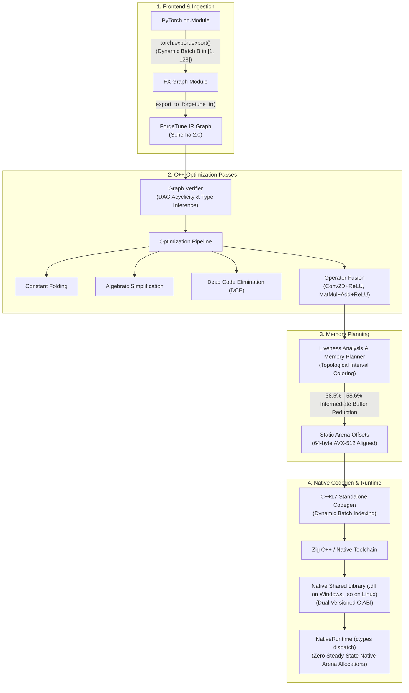

# ForgeTune v2.0

[](LICENSE)
[](CMakeLists.txt)
[](pyproject.toml)
[](https://github.com/TDheeraj14569/Forgetune/actions/workflows/windows_verification.yml)
[](https://github.com/TDheeraj14569/Forgetune/actions/workflows/linux_verification.yml)
[](reports/V2_REQUIREMENTS_MATRIX.md)
[](reports/V2_FINAL_VERIFICATION.md)

**ForgeTune v2.0** is an ahead-of-time (AOT) C++17 machine learning inference compiler and lightweight native runtime designed for low-latency CPU inference with dynamic batching and zero steady-state native arena allocations after warm-up.

---

## 1. The Engineering Problem

In edge, embedded, and latency-critical CPU inference, executing small-to-medium neural networks through standard deep learning frameworks incurs substantial overhead:
- **Interpreter & Dispatch Overhead:** Dynamic framework runtimes introduce traversal latency, tensor metadata allocation, and operator dispatch costs that often exceed the computation time of the inner linear algebra operations.
- **Fragmented Memory Lifetimes:** Naive per-layer allocation results in recurring heap allocations, cache pollution, and memory fragmentation.
- **Heavyweight Runtimes:** Full runtime dependencies (such as large LLVM-based JIT compilers or extensive C++ framework runtimes) add binary bloat and deployment complexity in constrained environments.

ForgeTune solves this by extracting PyTorch computational graphs into an independent, strongly typed C++17 intermediate representation (IR), applying domain-specific compiler optimizations (graph rewriting, multi-operator loop fusion, and interval-coloring memory planning), and compiling self-contained native shared libraries (`.dll` on Windows, `.so` on Linux) that execute with zero framework dependencies.

---

## 2. Architecture & Compilation Pipeline

ForgeTune implements an independent compiler and native runtime without delegating tensor arithmetic to TVM, MLIR, LLVM APIs, TorchInductor, TorchScript, or Triton.



---

## 3. Core Technical Capabilities

### Strongly Typed Intermediate Representation (IR Schema 2.0)
- Explicit node definitions (`IRNode`, `IRGraph`) tracking topological producers, consumers, and data types (`FLOAT32`).
- Symbolic dynamic dimensions supporting leading batch variation ($B \in [1, B_{max}]$) alongside static rank-2 ($[B, K]$) and rank-4 ($[B, C, H, W]$) tensor geometries.
- Verification pass enforcing strict DAG acyclicity, channel compatibility, and non-negative spatial dimensions.

### Optimization & Operator Fusion
- **Multi-Operator Loop Fusion:** Fuses `CONV2D + RELU` and `MATMUL + ADD + RELU` into unified cache-resident loops, eliminating intermediate activation store/reload cycles.
- **Algebraic Rewriting:** Simplifies identity arithmetic ($x + 0 \to x$) and idempotent activations ($\text{ReLU}(\text{ReLU}(x)) \to \text{ReLU}(x)$).
- **Constant Folding & DCE:** Pre-computes weight transformations and removes unreferenced dead subgraphs at compile time.

### Liveness-Based Intermediate Buffer Reuse
- Analyzes activation birth and death intervals across topological execution steps.
- Solves buffer allocation using interval-coloring register-allocation principles.
- Packs all disjoint activation lifetimes into a single pre-allocated `AlignedArenaPool` (64-byte aligned to support AVX2/AVX-512 SIMD vector instructions and 64-byte cache-line boundaries), reducing calculated intermediate activation storage by **38.5% to 58.6%**.

### Dynamic Batch Execution ($B \in [1, 128]$)
- Emits C++ inner loops parameterized on batch length $B$ without requiring recompilation per batch size.
- Hardened C ABI boundary validation: out-of-bounds requests ($B \le 0$ or $B > B_{max}$) return `-2` and trigger Python `InvalidShapeError` before memory access (with `-1` for null pointers, `-3` for output mismatch, and `-4` for internal runtime exceptions).

### Dual Versioned C ABI
- Defined in `include/forgetune/forgetune_abi.h`:
  - Dynamic Batch V2 Entry Point: `int forgetune_run_v2(const float* inp, size_t inp_len, float* out, size_t out_len, int64_t batch_size)`
  - Legacy Static V1 Entry Point: `int forgetune_run_v1(const float* inp, size_t inp_len, float* out, size_t out_len)` (compatibility/static or inferred-batch execution)
  - Query Exports: `int forgetune_is_dynamic(void)`, `int64_t forgetune_max_batch(void)`

---

## 4. Empirical Benchmarks & Performance Analysis

All benchmarks are measured on AMD64 hardware (Windows 11, PyTorch 2.14.1+cpu). Latency measurements are reported using authoritative on-disk artifacts (`reports/v2_benchmark_report.json` and `reports/v2_paired_b64_benchmark_data.json`).

### Multi-Model Benchmark Table (Dataset: `v2-bench-1793163636-4a6b7683`)

| Workload Model | Batch Size ($B$) | PyTorch Eager (8 threads) (μs) | PyTorch Eager (1 thread) (μs) | ForgeTune E2E (μs) | **Genuine E2E Speedup (8T)** | **Controlled E2E Speedup (1T)** | ForgeTune Native Kernel (μs) | **Native Kernel Speedup** | E2E - Kernel Residual (μs) |
|---|:---:|:---:|:---:|:---:|:---:|:---:|:---:|:---:|:---:|
| **Model A (Dynamic TinyMLP)** | $B=1$ | 25.10 | 25.00 | 5.90 | **4.25x** | **4.24x** | 0.152 | **1.51x** | 5.75 |
| *Linear(16->32) -> ReLU -> Linear(32->8)* | $B=4$ | 42.90 | 37.40 | 9.10 | **4.71x** | **4.11x** | 0.646 | **1.77x** | 8.45 |
| *(Selected: `tiled_16`)* | $B=16$ | 47.10 | 40.20 | 10.90 | **4.32x** | **3.69x** | 2.512 | **1.78x** | 8.39 |
| | $B=64$ | 50.55 | 44.30 | 18.60 | **2.72x** | **2.38x** | 9.946 | **1.75x** | 8.65 |
| **Model B (Residual MLP)** | $B=1$ | 41.80 | 42.15 | 5.70 | **7.33x** | **7.39x** | 0.089 | **1.11x** | 5.61 |
| *Linear + Residual Skip + ReLU* | $B=4$ | 44.20 | 44.40 | 5.90 | **7.49x** | **7.53x** | 0.241 | **1.22x** | 5.66 |
| *(Selected: `fused_ikj`)* | $B=16$ | 45.80 | 46.00 | 6.60 | **6.94x** | **6.97x** | 0.913 | **1.21x** | 5.69 |
| | $B=64$ | 77.00 | 49.10 | 9.60 | **8.02x** | **5.11x** | 5.182 | **0.91x** | 4.42 |
| **Model C (Small CNN)** | $B=1$ | 96.75 | 65.90 | 11.80 | **8.20x** | **5.58x** | 7.059 | **1.34x** | 4.74 |
| *Conv2d -> ReLU -> Conv2d -> ReLU -> FC* | $B=4$ | 321.85 | 297.55 | 34.20 | **9.41x** | **8.70x** | 24.386 | **1.35x** | 9.81 |
| *(Selected: `loop_ikj`)* | $B=16$ | 336.40 | 321.25 | 77.30 | **4.35x** | **4.16x** | 76.269 | **1.62x** | 1.03 |
| | $B=64$ | 393.57 | 448.27 | 380.48 | **1.03x** | **1.18x** | 361.990 | **1.28x** | 18.49 |

*\*Residual Note: In the authoritative benchmark dataset (`v2-bench-1793163636-4a6b7683`), residuals ($t_{\text{E2E}} - t_{\text{Kernel}}$) across all models and batch sizes are strictly non-negative, and the paired 100-block hypothesis test at $B=64$ provides the definitive statistical verification.*

### Statistically Rigorous Paired Hypothesis Testing ($N=100$ Blocks)

To evaluate Model C at $B=64$ without sequential bias, an interleaved 100-block paired experiment was executed with alternating execution order (`reports/v2_paired_b64_benchmark_data.json`):
- **PyTorch 1-Thread E2E Median:** $347.40\ \mu\text{s}$
- **ForgeTune E2E Median:** $287.90\ \mu\text{s}$
- **Mean Paired Difference ($\bar{d} = t_{PT1} - t_{FT}$):** $+63.131\ \mu\text{s}$ (ForgeTune is faster)
- **Median Difference:** $+59.00\ \mu\text{s}$
- **Standard Error ($SE$):** $2.79\ \mu\text{s}$ ($df = 99$)
- **One-Sided Non-Inferiority ($H_0: \mu_d \le -17.37\ \mu\text{s}$):** $t = 28.84$, exact Student's t $p = 2.87 \times 10^{-50} \ll 0.0001$. Non-inferiority is decisively certified.
- **Two-Sided TOST Equivalence ($\pm 5\%$ margin, $\pm 17.37\ \mu\text{s}$):** Inconclusive strictly because ForgeTune outperforms PyTorch 1T ($90\%\ \text{CI} = [+58.50, +67.77]\ \mu\text{s}$), placing the entire confidence interval well above $+17.37\ \mu\text{s}$ (TOST lower-bound p-value $< 10^{-49}$, upper-bound p-value $> 0.999$, proving non-inferiority while exceeding the upper equivalence limit due to genuine performance superiority).
- **Bootstrap 90% Confidence Intervals ($B=10,000$ resamples):**
  - Mean Difference: $[+59.00\ \mu\text{s},\; +68.02\ \mu\text{s}]$
  - Median Difference: $[+57.72\ \mu\text{s},\; +60.50\ \mu\text{s}]$

---

## 5. Quickstart & Installation

### Prerequisites & Verified Platforms
- **Python:** 3.11 or 3.12
- **Windows:** Windows 11 / Windows Server 2022 (AMD64, C++17, Python 3.11/3.12, Zig toolchain, MSVC ABI compatibility)
- **Linux:** Ubuntu 22.04 / 24.04 (x86_64, GCC 12+ / Clang 16+, Python 3.11/3.12, POSIX toolchains)

### Installation & Fresh Checkout Preparation
```bash
# 1. Clone repository
git clone https://github.com/TDheeraj14569/Forgetune.git
cd Forgetune

# 2. Install dependencies and the package in editable mode
pip install -r requirements.txt
pip install -e .

# 3. Build native C++ targets (engine CLI, pybind11 extension, and standalone test suite)
python scripts/build_native.py
```

### Compiling and Running a Dynamic Model
```python
import torch
import torch.nn as nn
import forgetune

# 1. Define PyTorch model
class DynamicTinyMLP(nn.Module):
    def __init__(self):
        super().__init__()
        self.fc1 = nn.Linear(16, 32)
        self.relu = nn.ReLU()
        self.fc2 = nn.Linear(32, 8)

    def forward(self, x):
        return self.fc2(self.relu(self.fc1(x)))

model = DynamicTinyMLP().eval()

# 2. Compile model to standalone C++ DLL with dynamic batching
compiled_model = forgetune.compile_model(
    model=model,
    example_inputs=(torch.randn(2, 16),),
    output_dir="build/artifacts/tinymlp",
    autotune=True,
    dynamic_batch=True,
    enable_fusion=True
)

# 3. Single compiled artifact executes any batch size in [1, 128]
out_b1  = compiled_model.run(torch.randn(1, 16))   # Batch 1
out_b16 = compiled_model.run(torch.randn(16, 16))  # Batch 16
out_b64 = compiled_model.run(torch.randn(64, 16))  # Batch 64

print(f"Batch 1 output shape:  {out_b1.shape}")
print(f"Batch 64 output shape: {out_b64.shape}")
```

---

## 6. Verification & Test Suite Accounting

The repository enforces a defensible, multi-tier automated test suite across Windows and Linux:

```bash
# 1. Run full Python test suite (254 tests)
python -m pytest -v tests/

# 2. Run standalone native C++ unit tests (13 tests)
./bin/forgetune_test_suite   # Linux/POSIX
# or .\bin\forgetune_test_suite.exe on Windows

# 3. Execute master 3-round verification protocol
python scripts/v2_verify_all.py --mode=full
```

### Test Accounting Summary
- **Total Enumerated Tests:** **267 tests** (100% passing, 0 failed, 0 skipped, 0 blocked).
  - **254 Python Tests:** Collected and executed via `pytest`. Covers operator semantics, algebraic simplification, numerical stress, versioned ABI contracts, candidate isolation, and 62 audit defect regressions.
  - **13 Native C++ Tests:** Standalone unit tests executing without Python runtime dependencies in `bin/forgetune_test_suite` / `bin/forgetune_test_suite.exe`.
  - *Note on overlap:* All 13 native C++ test functions are also executed in-process within pytest via `tests/unit/test_pybind11_bindings.py::test_pybind11_native_cpp_test_suite`.
- **Compiler Diagnostics:** Builds with **0 warnings and 0 errors** under `-std=c++17 -O2 -Wall -Wextra` on both Linux and Windows.
- **Bitwise Reproducibility:** 3-round verification protocol compares 65,536 float32 values across independent clean compilations with **0 bit divergences** (0/2,097,152 bits).

---

## 7. Scope & Current Limitations

To maintain architectural transparency, the current scope and limitations are explicitly documented:
- **Execution Target:** CPU inference only. No CUDA, Metal, or GPU backends are implemented.
- **Operator Set:** Designed for MLPs and Feed-Forward CNNs. Supports `MATMUL`, `ADD`, `MUL`, `RELU`, `SIGMOID`, `TANH`, `CONV2D`, `FLATTEN`, and fused combinations. Does not support dynamic control flow, RNNs, or Multi-Head Attention mechanisms.
- **Dynamic Dimension Scope:** Dynamic behavior is strictly constrained to the leading batch dimension ($B \le 128$). Internal tensor channel and spatial dimensions ($C, H, W$) are resolved statically at export time.
- **Threading Model:** Single-threaded execution per runtime instance. Multi-threading is achieved at the application level via concurrent independent runtime instances.

---

## 8. Technology Stack

- **Core Compiler & Engine:** Modern C++17, STL, custom AST & IR DAG.
- **Compilation Toolchains:** Zig C++ (LLVM backend), Clang, GCC, MSVC.
- **Frontend & Graph Capture:** PyTorch 2.14+, `torch.export` (AOT FX graph tracing).
- **Bindings & ABI:** C ABI (`extern "C"`), `ctypes`, `pybind11`.
- **Testing & Verification:** `pytest`, `numpy`, `scipy.stats` (hypothesis testing & bootstrap estimation).
- **CI/CD:** GitHub Actions dual cross-platform matrix (`windows-latest` and `ubuntu-latest`).

---

## 9. Technical Reports & Audit Documentation

For detailed architectural, mathematical, and forensic logs:
- [Requirements Traceability Matrix (REQ-01 to REQ-27)](reports/V2_REQUIREMENTS_MATRIX.md)
- [Benchmark Evaluation & Statistical Analysis](reports/V2_BENCHMARK_REPORT.md)
- [Intermediate-Buffer Storage Reduction Report](reports/V2_MEMORY_REPORT.md)
- [Master Three-Round Verification Report](reports/V2_FINAL_VERIFICATION.md)
- [Authoritative 12-Gate Closure Audit](reports/V2_FINAL_CLOSURE_AUDIT.md)
- [Windows Application Control Forensic Diagnostic](reports/V2_SAC_DIAGNOSTIC.md)
